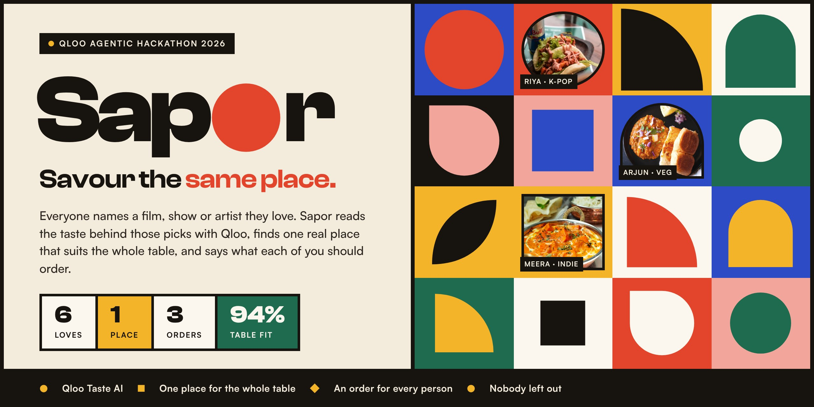
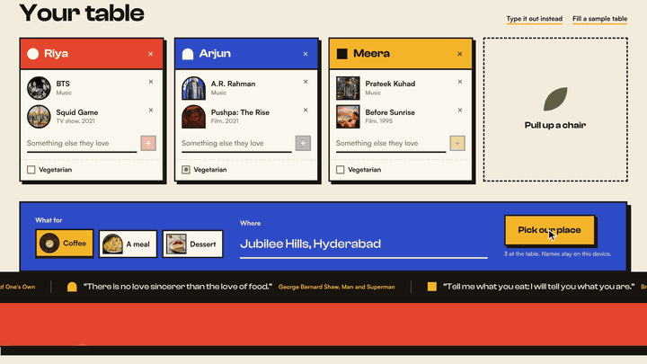
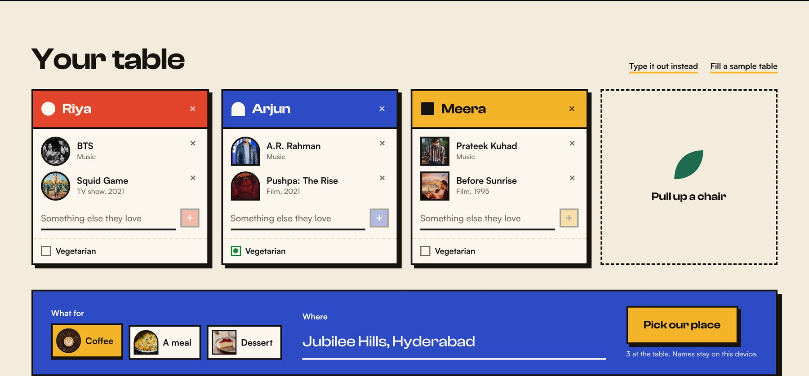
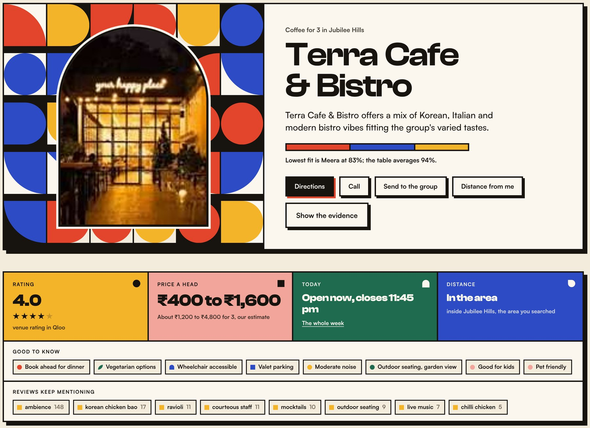
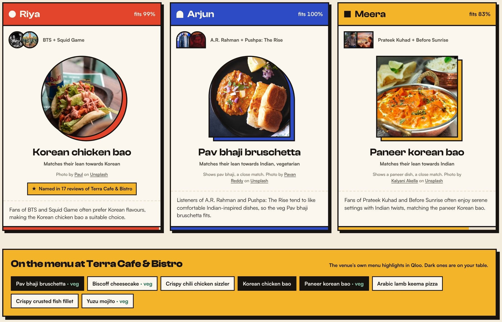
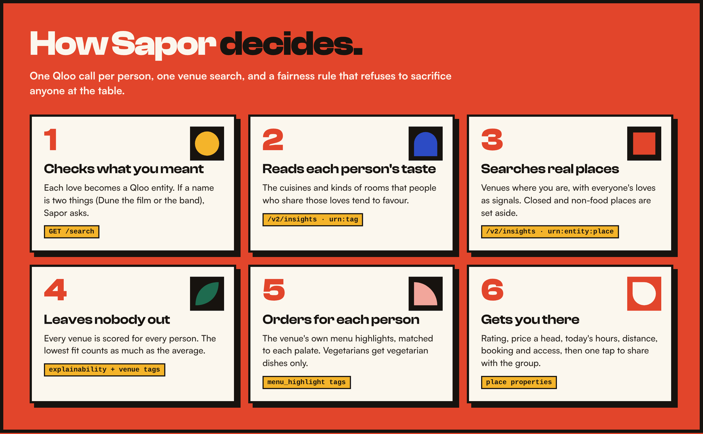

<p align="center">
  
</p>

<p align="center">
  <a href="https://sapor-nu.vercel.app"></a>
  <a href="https://youtu.be/5l6xLzkGpoI"></a>
  <a href="https://qloo.devpost.com/"></a>
</p>
<p align="center">
  
  
  
  
  
  
</p>

<p align="center"><b>
  <a href="https://sapor-nu.vercel.app">🔴 Try it live: sapor-nu.vercel.app</a> ·
  <a href="#-see-it-run">See it run</a> ·
  <a href="#-what-you-get">What you get</a> ·
  <a href="#-how-sapor-decides">How it decides</a> ·
  <a href="#-why-this-needs-qloo">Why Qloo</a> ·
  <a href="#-run-it-yourself">Run it</a>
</b></p>


## 🍽 "Where should we go?"

It is the most asked and worst answered question in every group chat. Popularity lists and star ratings tell you what is busy, not what fits **these** people. The loudest person picks, and someone sits through a meal that was never for them.

People are bad at describing food taste in the abstract, but brilliant at naming what they love. **Sapor** (Latin for *taste*) turns those loves into a decision:

> **Everyone names a film, show or artist they love. Sapor reads the taste behind those picks with Qloo, finds one real place nearby that suits the whole table, and says what each person should order there, with the evidence for every line.**


## ▶ See it run

<p align="center">
  <a href="media/sapor-launch.mp4"></a>
</p>
<p align="center"><sub>One continuous take of the real app on the sample table. <a href="https://youtu.be/5l6xLzkGpoI"><b>Watch the 2:25 demo video</b></a> (the app, then how it works with Qloo), or the <a href="media/sapor-launch.mp4">35 second launch film</a>.</sub></p>


## 🎟 What you get

<table>
  <tr>
    <td width="50%" valign="top">
      
      <h3>🔴 1 · Seat the table</h3>
      Each person adds up to three loves. Qloo's own artwork appears in that person's shape. Mark anyone vegetarian, choose coffee, a meal or dessert, and say where.
    </td>
    <td width="50%" valign="top">
      
      <h3>🔵 2 · One real place, ready to go</h3>
      The venue that fits the <i>whole</i> table, the fairness bar, and everything you need before leaving: rating, price range, a labelled estimate for the table, open now, distance, booking, parking and access.
    </td>
  </tr>
  <tr>
    <td colspan="2" valign="top">
      
      <h3>🟡 3 · An order for every person</h3>
      Dishes come from <b>that venue's own menu highlights</b> in Qloo, matched to each palate. Every dish gets a real, credited photo. When Qloo's review keywords for the venue mention the dish, Sapor shows the count. Vegetarians are only given dishes whose names carry no meat, fish or egg, flagged "confirm with staff".
    </td>
  </tr>
</table>

### Everything on the pick is real data

| | What Sapor shows | Where it comes from |
| :-- | :-- | :-- |
| ⭐ | **Venue rating**, with stars | Qloo `business_rating` |
| 💸 | **Price range**, and an estimate for the whole table | Qloo cost tag, shown as written (₹400 to ₹1,600, or ₹2,000+ when Qloo gives only a floor). Qloo does not say whether it is per person, so the table figure is labelled as our estimate |
| 🕒 | **Open now / closes at**, plus the week's hours | Qloo `hours`, read in the venue's own time zone |
| 📍 | **Distance**: from you (opt in, stays on your device) or from the area's centre | Your browser's location and Qloo's coordinates |
| ✅ | **Good to know**: booking, vegetarian options, wheelchair access, parking, noise, outdoor seating, kids, pets, payments | Qloo place tags |
| 💬 | **Reviews keep mentioning**, with counts | Qloo review keyword counts (how Qloo counts them is not documented) |
| 📋 | **Menu highlights**, with vegetarian-by-name dishes marked | Qloo `menu_highlight` tags and `specialty_dishes`. Not a live menu, so check on arrival |
| 📸 | **Their photos** and **See the real one** | The venue's Google Maps page via Qloo's `external.google_place` id, and an image search for each dish at that venue. Sapor links out and never copies these photos |
| 📲 | **Directions, Call, Send to the group** | Coordinates, phone, and a ready-to-paste summary for the chat |


## 🧠 How Sapor decides

<p align="center"></p>

<details>
<summary><b>The full agent loop, step by step</b></summary>

1. **Checks what you meant.** Each love is resolved to a Qloo entity. If a name is genuinely ambiguous (Dune the 2021 film, the book, or the German techno group), the agent stops and asks instead of guessing, because each draws a different crowd.
2. **Reads each person's taste.** One Qloo call per person returns the cuisines and kinds of rooms that people who share those loves tend to favour.
3. **Searches real places nearby.** One Qloo call finds venues in the neighbourhood you typed, with everyone's loves (and the table's shared tags) as signals.
4. **Guards and widens.** Venues Qloo lists as permanently closed, and venues with no cuisine or menu data (Qloo's cafe filter sometimes returns gyms), are set aside. If too few remain, the search widens step by step, and the app says so.
5. **Makes sure nobody is left out.** Every venue is scored for every person against the venue's own Qloo tags, blended with Qloo's per-signal explainability. Then the venues are ranked weakest person first (see the formula below).
6. **Writes each order.** Sapor maps the venue's menu highlights to each person's cuisines, respects vegetarians strictly, prefers desserts for a dessert outing, never defaults anyone to alcohol, and labels a dish "house favourite" when it is not a taste match. The link from a dish name to a cuisine is Sapor's own keyword map, not Qloo data, and a dish two people share is labelled as such.
7. **Explains itself.** One short line per person, written by Groq (`gpt-oss-120b`) with Gemini Flash-Lite as the fallback, from the evidence alone. A validator rejects any line that addresses the reader, praises food with words not in the data, leaks a seat letter, or uses an em dash, and falls back to a template.
8. **Gets you there.** Rating, price, hours, distance and practical facts from the venue's Qloo record, then directions, a call button and a summary to paste into the group chat.

</details>

### The ranking, in one line

```
table score = 0.60 × weakest person's match + 0.25 × average match + 0.15 × Qloo affinity for the venue
```

- A **match** (0 to 1) is how much of one person's Qloo taste profile (cuisines and kinds of room) the venue's own Qloo tags carry, nudged up when a dish fits them and down when none does. It is **not** a probability that they will enjoy it, and the app says so.
- **Qloo affinity** (0 to 1) is Qloo's own score for the venue given the whole table's signals. Among nearby candidates it sits in a narrow band, so at 15% it only settles near ties. It can never move a score by more than 0.15, so it cannot outweigh a 25 point gap in the weakest match.
- Ties go to the better weakest match, then the better average, then the name, so the same input always gives the same order.
- Why not Qloo's affinity alone? An earlier version let a venue Qloo loved win even when one guest matched it at 35%. That counterexample, the live case it broke, and a strict maximin baseline are all in [`tests/score.test.ts`](tests/score.test.ts).


## 🔑 Why this needs Qloo

Without Qloo this app has nothing to reason with. The three things it cannot get anywhere else:

- **Cross-domain taste.** Measured on 21 Oct 2026 with live calls: fans of BTS and Squid Game lean Korean, Thai, Chinese and Japanese and like hip, funky rooms; fans of A. R. Rahman and Pushpa lean Indian and like comfortable rooms; fans of Prateek Kuhad and Before Sunrise lean Indian and like serene ones.
- **Venue tags at dish level.** Real venues come back with cuisine, ambience, decor and menu-highlight tags, so a K-pop fan at Terra Cafe & Bistro in Jubilee Hills gets the Korean chicken bao, and a vegetarian at the same table gets the pav bhaji bruschetta.
- **The practical layer.** The same record carries the rating, price range, hours, coordinates, accessibility, parking and review keywords, so the pick is something you can actually go to tonight.

### Qloo workflows used

| Step | Endpoint | Parameters that matter | Why |
| :-- | :-- | :-- | :-- |
| Resolve a love | `GET /search` | `query`, `types` = artist, movie, tv_show, book, podcast, videogame | Free text to an entity id, with alternatives for ambiguity checks |
| Taste profile | `GET /v2/insights` | `filter.type=urn:tag`, `signal.interests.entities`, `filter.tag.types=urn:tag:cuisine:qloo,urn:tag:ambience:qloo` | What each person's crowd favours in food and rooms |
| Venue search | `GET /v2/insights` | `filter.type=urn:entity:place`, `signal.interests.entities`, `signal.interests.tags`, `filter.tags`, `filter.location.query`, `feature.explainability=true` | Real nearby venues, their tags, practical properties, and how much each person's signals contributed |

A full group plan costs about one Qloo call per person plus one venue search, and repeats are served from a six-hour cache.

<details>
<summary><b>A request, start to finish (redacted)</b></summary>

Table: three people in Jubilee Hills, Hyderabad, out for coffee. The second person is vegetarian.

1. `/search?query=BTS` resolves to *BTS* (artist). `/search?query=Dune` returns a film, a book and an artist with near-identical popularity, so the UI asks.
2. Taste profile for person A (BTS, Squid Game): cuisines Korean 0.87, Thai 0.86, Chinese 0.81; rooms Hip 0.91.
3. Venue search: cafes in "Jubilee Hills, Hyderabad", signals = all six entities plus the table's top shared tags. 30 venues back; 2 set aside with no food data.
4. Scoring: Terra Cafe & Bistro matches A on Korean, Thai, Japanese; B on Comfortable, Italian, Welcoming and is tagged vegetarian-friendly; C on Comfortable, Italian, Intimate. Weakest match 83%, average 94%. Table score 0.85, ahead of Roast CCX at 0.78, whose weakest match is 74% despite a higher Qloo affinity.
5. Orders from Terra's menu highlights: A, Korean chicken bao (Korean); B, Pav bhaji bruschetta (Indian, vegetarian); C, Paneer Korean bao (Indian).
6. Before you go: rated 4.0, price range ₹400 to ₹1,600 (about ₹1,200 to ₹4,800 for three if that is per person), open noon to 11:45 pm, book ahead for dinner, valet parking, wheelchair accessible.

Names typed in the app never leave the browser. The server sees seats as A, B, C, and Qloo only ever receives entity ids, tag ids and a place name. Your location, if you share it, is only used in the browser to measure distance.

</details>


## 🛠 Run it yourself

Requirements: Node.js 22.19 or newer, a Qloo hackathon key.

```sh
git clone https://github.com/victorisaacchinta-eng/sapor.git
cd sapor
npm install
cp .env.example .env.local      # then put your keys in .env.local
npm run dev                      # http://localhost:3000
```

| Variable | Needed? | What it does |
| :-- | :-- | :-- |
| `QLOO_API_KEY` | **Required** | Every taste and venue lookup |
| `UNSPLASH_ACCESS_KEY` | Recommended | Real dish photos; without it dishes are shown by name |
| `GROQ_API_KEY` | Optional | Writes the one-line explanations (`gpt-oss-120b`) |
| `GEMINI_API_KEY` | Optional | Fallback writer (`gemini-flash-lite-latest`) |

Without a language key, Sapor still parses "Name: thing, thing" input with simple rules and writes its explanations from templates. To deploy, import the repo into Vercel and add the same variables. Every Qloo call happens in server routes (`src/app/api/*`); keys never reach the browser.

### Tests

```sh
npm test       # ranking, dishes and price parsing, no keys needed
```

22 unit tests cover the fairness counterexample and maximin baseline, the live ranking regression, vegetarian and alcohol rules on real menu names, shared dishes, and open-ended prices.

<details>
<summary><b>Project layout</b></summary>

```
src/lib/qloo.ts                server-only Qloo client: timeout, one bounded retry, LRU cache
src/lib/agent.ts               resolution, taste profiles, venue search, guardrails, fairness, place details
src/lib/score.ts               the ranking: weakest person first, pure and tested
src/lib/cost.ts                Qloo price text to a range, a floor or words, never guessed
src/lib/dishes.ts              dish-to-cuisine map, vegetarian, dessert and alcohol rules
src/lib/photos.ts              Unsplash dish photos: named-dish matching, veg-safe, ingredient fallback, credits
src/lib/llm.ts                 optional language layer, provider fallback chain, copy validator
src/app/api/                   resolve, plan (streams the agent's steps), parse, img (Qloo image relay), dish-photo
src/components/Sapor.tsx       the interface
src/components/PlaceFacts.tsx  rating, price, hours, distance, practical facts, directions and sharing
src/components/art.tsx         mosaic and seat shapes
tests/                         node:test suites (npm test)
```

</details>

## ⚠️ Known limitations

- **Qloo describes groups, not people.** An affinity says what people who love BTS *tend to* like. It is not a prediction about your friend, and the app words it that way.
- **No dish prices or dish ratings.** Qloo has the venue's price range and rating, not a price or star rating per dish. Sapor shows the venue's range, a labelled estimate for the table, and how many reviews name a dish, and never invents the rest.
- **Direct venue ranking is flat.** Qloo's own venue order changes less between very different tastes than you might expect. Sapor's re-ranking on each venue's tags is what makes picks differ; it is our method, not a Qloo score.
- **Dish matching and vegetarian checks are keyword based.** Unusual dish names can be missed (the UI says "house favourite"). Dishes usually made with meat (bao, momos, ramen, burgers) only count as vegetarian when the name says so. Check with the venue.
- **Dish photos are stock, not the venue's own.** Each is a real, credited photo of the named dish (or, for a veg dish with no clean match, of its key ingredient, labelled "a close match"). The venue's own and diners' photos belong to them or to the platforms they were posted on (Zomato and Swiggy terms bar copying them), and there is no licensed API that labels venue photos by dish. So Sapor links to them instead: **Their photos** opens the venue's Google Maps page, and **See the real one** searches for that dish at that venue.
- **Distance is a straight line.** Tap Directions for real travel time.
- **Coverage varies by city.** Menu highlights are rich in Hyderabad, Bengaluru and Brooklyn; thinner in some neighbourhoods and smaller towns.
- **Some cafe results are not cafes.** Qloo's cafe filter can return a viewpoint or a museum cafe (in Shoreditch it returned Sky Garden). Venues with no cuisine or menu data are set aside, but a place with a cafe inside can still appear.
- **Match scores are not calibrated against real people yet.** They are comparable between people at the same table because each is measured the same way, but nobody has rated real outings against them.

## 🙏 Credits

Taste data, venue details and entity images: [Qloo](https://www.qloo.com/) Taste AI. Food photos: [Unsplash](https://unsplash.com/?utm_source=sapor&utm_medium=referral) photographers, credited on each photo (the banner uses dishes by Paul, Pavan Reddy and Kalyani Akella). Type: Clash Display and Satoshi by Indian Type Foundry, via Fontshare. Shapes, mosaic and launch film: original, made in code for Sapor. Narration voice: Gemini TTS via Google AI Studio. Music: Google Flow Music.


<p align="center"><b>Sapor · savour the same place.</b><br><sub>MIT licensed · built by Victor Isaac for the Qloo Agentic Hackathon, October 2026</sub></p>
